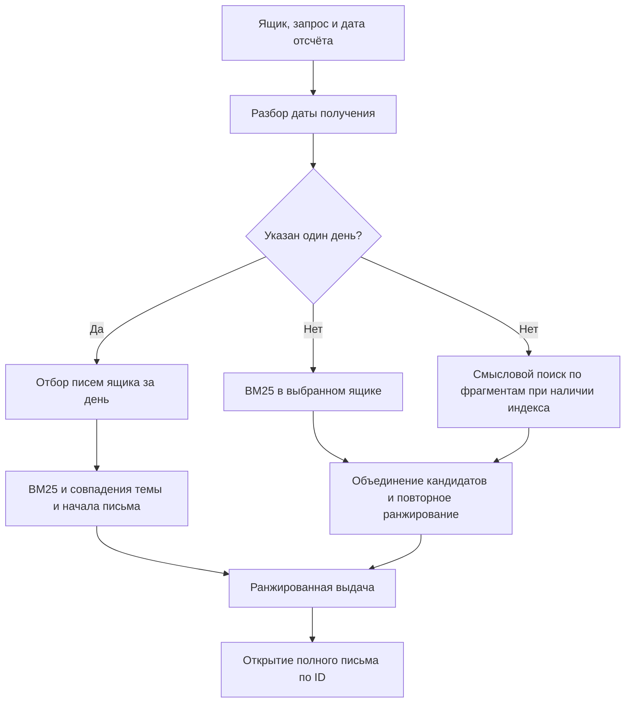

# Как работает умный поиск по почте

Прототип принимает запрос на обычном русском языке, ищет только в выбранном ящике и даёт открыть полное письмо из выдачи. Способ поиска зависит от смысла даты в запросе. «Покажи заказы, которые пришли вчера» сначала превращается в поиск по конкретному дню. «Как оплатить муниципальное жильё» запускает поиск по словам и по смысловой близости.

## 1. Данные и индексы

Сервер читает `documents.jsonl` из архива организаторов. На предоставленном архиве он открывает 16 376 писем в 12 почтовых ящиках. Документ имеет `doc_id`, идентификатор ящика `synthetic_user`, исходный текст `doc` и дату получения `doc_dt`, если она известна. Отправитель и тема могут находиться в самом тексте письма. Формат их записи варьируется, поэтому приложение отдельно извлекает эти поля для списка и просмотра.

При старте [бэкенд](../backend/app.py) строит данные в памяти:

| Структура | Что хранит | Для чего нужна |
| --- | --- | --- |
| Письма по `doc_id` | Исходный текст и поля письма | Быстро открыть письмо из выдачи |
| Письма по ящику | Список, отсортированный по убыванию даты | Пагинация входящих |
| Письма по ящику и дню | Множество ID для пары «ящик, дата получения» | Отобрать письма точного дня до ранжирования |
| Обратный индекс | Для каждого терма множество писем, где он встретился | Найти лексических кандидатов через множества ID |
| Частоты и последовательности термов | Частоты по письму и теме, порядок слов, длина письма | BM25, совпадения в теме, порядок и близость слов |
| Статистика по ящику | Размер, средняя длина и частота документов с термом | Учитывать, какие слова редки именно в этом ящике |

Токенизатор выделяет числа и слова на кириллице и латинице, приводит буквы к нижнему регистру и нормализует «ё». Pymorphy3 приводит русские слова к начальной форме. Например, «контейнеров» и «контейнерами» становятся словом «контейнер». Результаты разбора повторяющихся слов кешируются. Для отбора по точной дате письму нужна распознанная дата получения. При более широком поиске письмо без даты может попасть в выдачу.

### Смысловой индекс

[Офлайн-скрипт](../backend/build_semantic_index.py) делит письмо на фрагменты до 80 слов с перекрытием 16 слов. Большое письмо может описывать несколько событий, а фрагменты позволяют сравнивать запрос с каждым из них. Мультиязычная модель Potion на 128 млн параметров превращает каждый фрагмент в вектор из 256 чисел. На предоставленном архиве получилось 25 832 фрагмента. Векторы нормализуются и сохраняются вместе с идентификатором модели и привязкой к документам.

Модель и векторы находятся в `backend/.cache/`. При запуске сервер проверяет кеш, модель, форму массива, идентификаторы писем и принадлежность каждого вектора ящику из архива. Затем группирует векторы по ящику. Модель запускается локально. Скачивание весов происходит при подготовке кеша, а запросы и письма обрабатываются на машине с индексом.

## 2. Запрос из браузера

Интерфейс на React и Vite запрашивает список ящиков и первую страницу входящих. Ящик можно сменить. Фильтр «Поиск до» относится к поиску и допускает письма вплоть до выбранного дня.

Запрос отправляется в `POST /search`. Например, в демонстрационном ящике запись выглядит так:

```json
{
  "synthetic_user": "box-f9410417c091",
  "query": "Какие заказы пришли вчера?",
  "query_date": "2026-11-21",
  "limit": 20
}
```

`synthetic_user` задаёт область поиска. В обоих режимах кандидаты берутся из этого ящика. `query_date` задаёт день отсчёта для относительной даты и верхнюю границу для писем с известной датой. Если поле пустое, относительная дата вычисляется от текущего дня сервера, а верхняя граница по полю запроса не применяется. Максимальная длина запроса в API составляет 1000 символов, а максимальный лимит выдачи — 100 писем. Интерфейс запрашивает до 50 совпадений и показывает число возвращённых записей.



## 3. Поиск по точному дню

[Разбор даты](../backend/query_dates.py) распознаёт записи вроде «20 ноября 2026», `20.11.2026`, `2026-11-20`, а также «сегодня», «вчера» и «позавчера». Из тематической части запроса убираются распознанная дата и вводные слова. Если встречаются две даты или конструкция диапазона, парсер оставляет запрос широкому поиску. Для одной явно заданной даты позже `query_date` сервер возвращает пустую выдачу.

В демонстрационном примере «вчера» при дате отсчёта 21 ноября превращается в 20 ноября. Сервер ограничивает кандидатов письмами от 20 ноября в выбранном ящике, а затем ищет в них упоминания заказов. Значение `received_on` передаётся в ответе. По нему браузер показывает строку «Получено 20 ноября 2026».

### Отбор и оценка BM25

BM25 больше ценит слова, которые редко встречаются в письмах этого ящика. Дополнительные повторы одного слова постепенно теряют вес. Длина письма также учитывается, поэтому длинное письмо не поднимается автоматически за счёт большего числа слов. Повышение веса совпадений в теме и покрытие тематических термов помогают различить письма со схожими словами.

Сначала пересекаются списки писем, где встретились термы запроса, с множеством писем заданного дня. Если после удаления даты осталась пустая тематическая часть, выдача может состоять просто из писем за этот день.

### Уточнение темы внутри дня

[Детерминированное ранжирование](../backend/receipt_ranking.py) учитывает содержание всех писем выбранного дня. Для длинных русских слов оно проверяет совпадение общего префикса из шести букв. Так «погрузка» может найти «погрузить», даже если их нормальные формы различаются. Числовые идентификаторы и латинские слова сравниваются без этого расширения.

Внутри дня оценка складывается из нормированного лексического балла, покрытия тематических слов, совпадений в начале письма и теме, а также близости совпадений. Текущая формула имеет вид `BM25 / max_BM25 + покрытие + 2 × начало + 1,5 × тема + 0,6 × близость`. Покрытие делится на число содержательных термов. Для «начала» вес первого вхождения на позиции `i` равен `1 / (1 + i / 18)`. Близость зависит от расстояния между первым и последним из найденных первых вхождений.

Например, письмо об успешной оплате может несколько раз упомянуть «платёж». Для запроса об отклонённых платежах важнее, что действие «отклонить» прямо указано в теме письма. Общий префикс также помогает письмам о погрузке, в которых действие записано глаголом. При этом день и ящик остаются жёсткими ограничениями.

## 4. Поиск по словам и смыслу

Когда запрос не задаёт один день получения, доступны две независимые выдачи кандидатов:

1. **BM25** возвращает до 150 писем из выбранного ящика, которые лексически совпадают с запросом.
2. **Векторы Potion** возвращают до 150 писем из того же ящика. Вектор запроса нормализуется и сравнивается с векторами фрагментов. Скалярное произведение нормированных векторов равно косинусному сходству. Оценка письма — лучший результат среди его фрагментов. Соответствие «фрагмент → письмо» сохраняется при загрузке. NumPy вычисляет максимум по фрагментам сразу для всего массива, а при одинаковых оценках письма упорядочиваются по ID.

Кандидаты объединяются по `doc_id`. Один документ может присутствовать в обоих списках. Если задана верхняя граница, она применяется к обоим источникам. Для каждого кандидата вычисляются 14 признаков. Они описывают баллы и позиции BM25 и векторного поиска, покрытие слов и редких слов, совпадения в теме, длины письма и запроса, общие числа, соседние слова и объединённый ранг.

[Подготовка признаков](../backend/search_features.py) один раз нормализует и собирает данные запроса для всех кандидатов. Например, веса редкости слов одинаковы для конкретного запроса и ящика. Для соседних слов движок сначала проверяет наличие двух термов в письме. Порядок проверяется у возможных пар и просмотр прекращается, когда все они найдены. Та же реализация применяется в [обучающем скрипте](../backend/reranker_experiment.py) и в API.

LightGBM LambdaMART получает строки признаков и оценивает порядок кандидатов. Последняя модель из ветки `search-hybrid` использует 150 деревьев и максимальную глубину 3. Её оценки служат для сортировки и не выражают вероятность. Когда векторный индекс доступен, а модель LightGBM отсутствует, позиции объединяются через взвешенное reciprocal rank fusion. Если векторный индекс недоступен, остаются BM25, морфология и точный отбор по дате.

## 5. Что получает интерфейс

| Маршрут | Результат |
| --- | --- |
| `GET /health` | Число писем и доступность режимов поиска |
| `GET /mailboxes` | Идентификаторы ящиков и число писем |
| `GET /mailboxes/{synthetic_user}/messages?offset=0&limit=20&preview=true` | Список входящих с короткими фрагментами |
| `POST /search` и `GET /search` | Ранжированные совпадения, дата, тема и фрагмент письма, а также `received_on` при точном дне |
| `GET /mailboxes/{synthetic_user}/messages/{doc_id}` | Полный текст письма в заданном ящике |

Письмо из выдачи открывается отдельным запросом. Сервер проверяет принадлежность письма указанному ящику перед выдачей текста. Письма рендерятся как текст. При смене ящика или запроса устаревшие запросы отменяются браузером, чтобы поздно пришедший ответ не заменил новую выдачу. Закладки сохраняются по ящикам в текущем браузере. На широком экране список и письмо видны одновременно, на узком письмо занимает рабочую область. Стрелки перемещают фокус по письмам, Enter открывает выбранное, Esc закрывает его.

## 6. Как оцениваем

Открытый набор содержит 99 запросов и 565 пар «запрос, релевантное письмо». Для каждого запроса берём фиксированный список правильных ID из разметки и сравниваем с выдачей.

- **Recall@10** показывает, какая доля всех известных релевантных писем попала в первые десять.
- **Recall@100** показывает, какая доля нашлась в первых ста.
- **nDCG@10** дополнительно ценит порядок. Правильное письмо на первой позиции даёт больше вклада, чем такое же письмо на десятой. Сумма делится на результат идеального порядка.
- **MRR@10** использует обратную позицию первого правильного письма среди первых десяти. Когда такого письма нет, запрос даёт 0.
- **p99 HTTP** показывает задержку, в которую уложились 99% измеренных ответов. Локальный HTTP-прогон включает обработку сервером, сериализацию и передачу по loopback. Отдельный `evaluate.py` измеряет функции внутри процесса.

| Конфигурация на тех же 99 запросах | Recall@10 | Recall@100 | nDCG@10 | MRR@10 |
| --- | ---: | ---: | ---: | ---: |
| BM25 без разбора даты | 0,5239 | 0,8637 | 0,3665 | 0,3582 |
| Точная дата и прежнее ранжирование | 0,8879 | 0,9923 | 0,9304 | 0,9503 |
| Точная дата и тематическое ранжирование | 0,9305 | 1,0000 | **0,9890** | 0,9949 |

Эти 99 запросов указывают день получения. Измерение гибридной модели проводят отдельно. В эксперименте с отключённым разбором даты на одном пятифолдовом разбиении по запросам обновлённая модель дала nDCG@10 **0,4825**, а при удержании целых ящиков — **0,4791**. В каждом фолде модель обучается без его оценочных запросов или ящиков. Этот эксперимент использует исходные публичные запросы и измеряет поведение при выключенной обработке дат. Нагрузка с удалёнными датами проверяет скорость гибридной ветки. Оценки релевантности с исходных запросов для неё не применяются.

Сравнение прежней и оптимизированной реализации проводили с одной и той же обновлённой моделью LightGBM. Порядок писем, оценки и поля ответов совпали на 99 исходных и 99 преобразованных запросах при лимите 100. Два нагрузочных прогона на 64 параллельных клиентах содержали по 495 запросов.

| Нагрузка | p99 до оптимизации | p99 после оптимизации |
| --- | ---: | ---: |
| Исходные запросы с датами | 96–367 мс | 97–319 мс |
| Те же запросы с убранным упоминанием даты получения | 717–792 мс | **491–495 мс** |

HTTP-прогоны выполнены локально на том же ноутбуке. Диапазоны показывают два результата и их разброс. Выигрыш относится к гибридному маршруту, где изменились расчёты признаков и агрегация фрагментов. Итоговую проверку проводят организаторы на закрытом наборе.

### Как повторить

Запустите команды из `backend/` после настройки окружения по [README](../README.md). При необходимости задайте `MAIL_DATASET_ZIP` абсолютным путём к архиву.

```bash
python evaluate.py --latency-repeats 5 --worst 10
MAIL_RECEIPT_RERANK=0 python evaluate.py --latency-repeats 5 --worst 10
MAIL_RECEIPT_DATES=0 python evaluate.py --mode lexical --latency-repeats 5
MAIL_RECEIPT_DATES=0 python reranker_experiment.py --depth 150
python stress_http.py --workers 8 32 64 --repeats 5
python stress_http.py --workers 8 32 64 --repeats 5 --without-receipt-dates
```

`--worst 10` выводит запросы с наибольшей потерей nDCG. Для разбора ошибок пригодится [комментарий с примерами погрузки, выгрузки и отклонённых платежей](https://github.com/Chpokarik/hahaton-vk-mail-search/commit/af50e00529edd30f8bc754b9c058872be026f69c#commitcomment-211175682).

## 7. Как запустить и проверить демо

FastAPI поднимается на порте 8000, Vite — на 5173. Для одной публичной HTTPS-точки React собирается с `VITE_API_BASE_URL=/`, а FastAPI раздаёт `frontend/dist/` при `MAIL_SERVE_FRONTEND=1`. HTTPS-туннель направляет браузерный трафик в этот порт. Инструкция запуска находится в [README](../README.md). Бесплатный адрес туннеля периодически меняется. Держите локальную копию открытой для защиты.

Через `GET /health` можно убедиться, что загружены все 16 376 писем. `semantic_search` показывает наличие смыслового поиска, `reranker` отвечает за загруженную модель LightGBM, `receipt_reranking` — за уточнение темы внутри дня. Если индекс отсутствует, для демонстрации запроса «заказы вчера» достаточно лексического маршрута. Для поиска по смыслу понадобится готовый локальный кеш.
